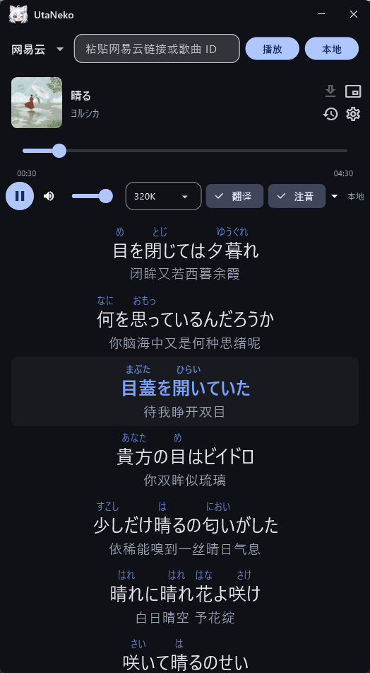
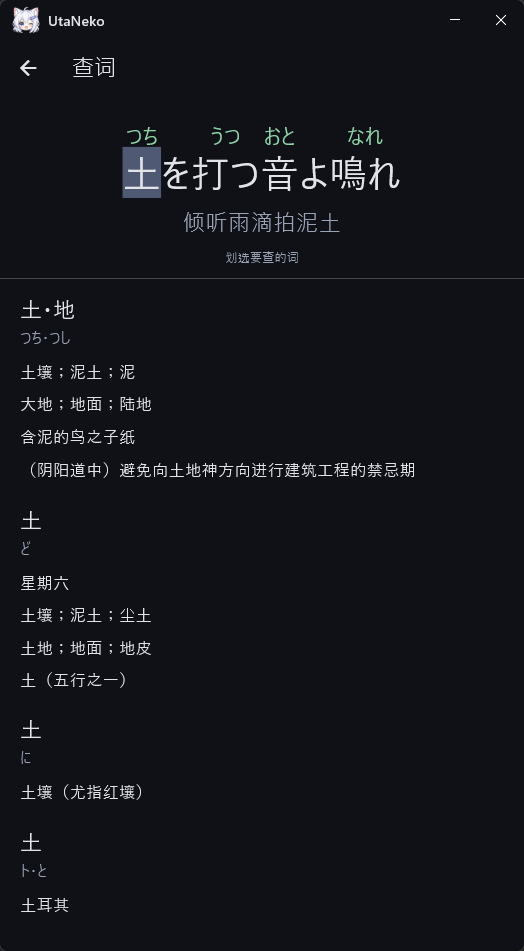
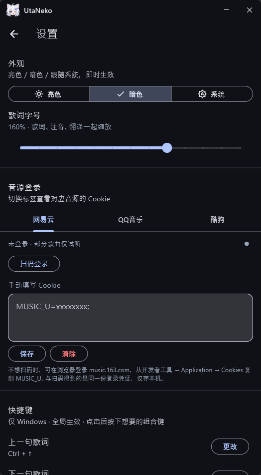
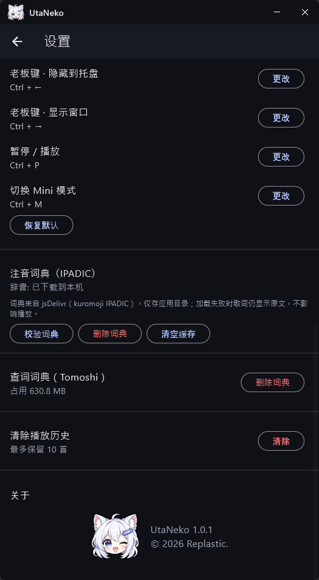

<h1 align="center"> UtaNeko · 歌喵</h1>

<a href="README.md">English</a> · <a href="README-zh.md">简体中文</a>

A cross-platform player that puts furigana on Japanese song lyrics

UtaNeko is a Flutter player for listening to Japanese songs with the kanji readings on screen. Paste a music platform link or song ID to start playback. Lyrics follow the music, and furigana sits above the kanji.

Dictionaries are downloaded only when needed and stay on the device. If a dictionary or the tokenizer fails, the original lyric line remains and playback continues.

The app currently runs on **Windows** and **Android**. Login credentials are stored only on this device.

## Screenshot
<table>
  <tr>
    <td></td>
    <td></td>
    <td></td>
    <td></td>
  </tr>
</table>

## Features

### Playback and lyrics

- Paste a music platform share link or song ID. Audio streams from the CDN.
- The current lyric line is highlighted. Tap a line to seek, and turn the translation on or off.
- Switch among 128K, 192K, 320K, and lossless without losing the playback position.
- The latest 10 tracks stay in local history and can be played again from the history list.
- Sign in with a QR code, or paste a cookie from the browser. The credential stays on this device and is used to request a playable URL. Without a matching account, some tracks remain previews.

### Furigana

- Readings come from kuromoji with the IPADIC dictionary. The dictionary is fetched from jsDelivr the first time furigana is needed, then kept in the app directory.
- Furigana is drawn as ruby text above the kanji. Token results are cached per track as JSON.
- If the download or tokenization fails, a message explains it and the lyrics fall back to the original text.

### Word lookup

- Long-press a lyric line, then select a word to look it up in a local Japanese–Chinese dictionary (JMdict via Tomoshi).
- The dictionary is downloaded from GitHub on first use. It can be removed in Settings and will be fetched again the next time you look a word up.

### Download

- Save the current track as a raw audio file, a sidecar `.lrc`, and cover art. Furigana can also be exported as HTML.
- The default folder is `Downloads/UtaNeko` (or the app documents folder when Downloads is unavailable). On Windows you can choose another directory.

### Windows desktop

- Mini mode is a small always-on-top window that shows the current line, its furigana, and the translation. The window leaves the taskbar; open the tray icon or double-click the Mini window to return to the main UI. Hover over Mini and scroll the mouse wheel to move to the previous or next lyric line.
- The boss key hides the window to the tray without stopping playback, then brings it back.
- Global hotkeys work while another app is focused. Defaults: Ctrl+Up / Ctrl+Down move between lyric lines, Ctrl+Left / Ctrl+Right hide and show the window, Ctrl+P plays or pauses, Ctrl+M toggles Mini. Each binding can be changed in Settings.

### Appearance

- Light, dark, or follow the system. The lyric text, furigana, and translation share one size slider.

## Platforms

| Platform | What you get |
| --- | --- |
| Windows | Player, furigana, lookup, download, Mini mode, tray, global hotkeys, and a custom title bar |
| Android | Player, furigana, lookup, download, history, and settings |

## Note

Inspired by and based on [utasensei](https://github.com/yichenbert/utasensei).

UtaNeko is for personal study. Please support official releases, and do not use it to bypass paid content or for commercial use. The lookup dictionary comes from JMdict (EDRDG) and Tomoshi (Y1Z) under CC BY-SA 4.0.

